# FinSight AI

<p align="center">
  
</p>

<p align="center">
  <strong>Transforming 3.2 Million Financial News Headlines into Actionable Market Intelligence &amp; Interactive Knowledge Networks</strong>
</p>

<p align="center">
  <a href="https://github.com/Yanshuptl18/FinSight_AI/stargazers"></a>
  <a href="https://github.com/Yanshuptl18/FinSight_AI/network/members"></a>
  <a href="https://github.com/Yanshuptl18/FinSight_AI/blob/main/LICENSE"></a>
  <a href="https://python.org"></a>
  <a href="https://streamlit.io"></a>
  <a href="https://finsight-ai-442154825091.us-central1.run.app"></a>
</p>

---

## Welcome to FinSight AI

Every trading day, thousands of financial news headlines hit the wires. For investors, equity analysts, and data scientists, staying on top of this flow manually is practically impossible. Even worse, most existing tools either give you a basic keyword search or slap a generic "positive / negative" sentiment label on an article without any real context.

**FinSight AI** is built to solve that problem.

It is an interactive financial intelligence platform that analyzes a verified dataset of **3,215,296 news headlines** across **6,619 companies** and **28 industry sectors** over an 11-year period (2009–2020). Using modern Natural Language Processing (NLP), machine learning, and graph analytics, FinSight AI turns raw news text into structured insights:

- What specific **event** is taking place (earnings surprise, leadership change, FDA approval, lawsuit)?
- How does the news ripple across **suppliers, competitors, and partners**?
- What macro **topics and industry trends** are gaining momentum?
- How does market sentiment translate into quantitative **company signals**?

Everything is brought together in **17 interactive dashboard modules** built with Python, Streamlit, Plotly, and PyVis.

---

## Quick Links

- **Live Web Application**: [https://finsight-ai-442154825091.us-central1.run.app](https://finsight-ai-442154825091.us-central1.run.app)
- **Streamlit Community Mirror**: [https://finshightai.streamlit.app](https://finshightai.streamlit.app/)
- **GitHub Repository**: [https://github.com/Yanshuptl18/FinSight_AI](https://github.com/Yanshuptl18/FinSight_AI)
- **Processed Dataset on Hugging Face**: [Yanshuptl18/finsight-ai-data](https://huggingface.co/datasets/Yanshuptl18/finsight-ai-data)
- **Original Source Dataset on Kaggle**: [Massive Stock News DB for NLP Backtests](https://www.kaggle.com/datasets/miguelaenlle/massive-stock-news-analysis-db-for-nlpbacktests)

---

## Table of Contents

- [Why FinSight AI?](#why-finsight-ai)
- [The Dataset at a Glance](#the-dataset-at-a-glance)
- [How It Works (Pipeline & Architecture)](#how-it-works-pipeline--architecture)
- [Platform Tour: 17 Interactive Dashboards](#platform-tour-17-interactive-dashboards)
  - [1. Command Center](#1-command-center)
  - [2. Executive Dashboard](#2-executive-dashboard)
  - [3. News Intelligence Explorer](#3-news-intelligence-explorer)
  - [4. Company Intelligence Explorer](#4-company-intelligence-explorer)
  - [5. Topic Intelligence Explorer](#5-topic-intelligence-explorer)
  - [6. Event Intelligence Explorer](#6-event-intelligence-explorer)
  - [7. Sector Intelligence Explorer](#7-sector-intelligence-explorer)
  - [8. Market Entity Network (Knowledge Graph)](#8-market-entity-network-knowledge-graph)
  - [9. Event Propagation Explorer](#9-event-propagation-explorer)
  - [10. Sector Correlation Network](#10-sector-correlation-network)
  - [11. Company Ecosystem Network](#11-company-ecosystem-network)
  - [12. Timeline Intelligence Explorer](#12-timeline-intelligence-explorer)
  - [13. Financial Intelligence Search (Semantic Search)](#13-financial-intelligence-search-semantic-search)
  - [14. Market Signals & Insights (Recommendation Center)](#14-market-signals--insights-recommendation-center)
  - [15. Download & Quantitative Report Center](#15-download--quantitative-report-center)
  - [16. System Configuration (Settings)](#16-system-configuration-settings)
  - [17. Platform Documentation (About)](#17-platform-documentation-about)
- [Smart Data Handling & Performance](#smart-data-handling--performance)
- [Technology Stack](#technology-stack)
- [Local Setup Guide](#local-setup-guide)
- [Data Attribution & License](#data-attribution--license)
- [Author & Contact](#author--contact)

---

## Why FinSight AI?

When looking at financial news, market participants typically run into four big challenges:

1. **Information Overload**: Over 3 million articles across thousands of publishers make manual reading impossible. You need a way to filter signal from noise in milliseconds.
2. **Context Beyond "Bullish" or "Bearish"**: A simple sentiment score doesn't tell you *why* a stock moved. Knowing that a headline represents an *acquisition*, a *regulatory approval*, or a *guidance cut* provides actionable context.
3. **Hidden Corporate Connections**: Companies don't exist in a vacuum. If a major semiconductor manufacturer faces a disruption, it impacts automotive suppliers, smartphone makers, and cloud providers. FinSight AI maps these relationships using entity networks.
4. **Fast Exploration on Normal Hardware**: Working with multi-gigabyte text datasets usually requires expensive clusters. FinSight AI uses columnar storage (Apache Parquet) and smart lazy loading so you can browse millions of rows smoothly without crashing your computer's memory.

---

## The Dataset at a Glance

All numbers below reflect the verified dataset used across FinSight AI:

| Metric | Verified Value | Details |
|:---|---:|:---|
| **Total Processed Headlines** | **3,215,296** | Cleaned and structured in `financial_intelligence_dataset.parquet` |
| **Historical Time Span** | **Feb 2009 &ndash; Jun 2020** | Over 11 years (136 consecutive months) of real market history |
| **Monitored Companies** | **6,619** | US equities and international cross-listed tickers |
| **News Publishers** | **1,047** | Global outlets, wire services, and analyst feeds |
| **Industry Sectors** | **28** | Standardized financial sector taxonomy |
| **Classified Event Types** | **30** | Categorized market catalysts (earnings, M&A, FDA, splits, etc.) |
| **Macro Topics** | **20** | Discovered using Transformer sentence embeddings & BERTopic |
| **Fine-Grained Sub-Clusters** | **2,913** | Latent topic clusters mapped via HDBSCAN & KMeans |
| **Extracted Named Entities** | **7,345,743** | Companies, people, agencies, and financial entities |
| **Knowledge Graph Nodes** | **7,720** | Connected companies, publishers, events, and sectors |
| **Knowledge Graph Relationships** | **427,023** | Verified co-occurrence and dependency links |
| **Corporate Supply Chain Ties** | **186,364** | Competitor, supplier, and partnership relationships |

### Sentiment Distribution Across 3.2M Articles

Most financial news is informational and factual, while strong catalysts create clear sentiment movements:

```text
Neutral:   2,749,781 articles (85.5%) — Routine market updates, earnings schedules, filings
Bullish:     353,631 articles (11.0%) — Upgrades, earnings beats, expansion, dividend hikes
Bearish:      83,267 articles  (2.6%) — Downgrades, guidance cuts, investigations, litigation
Mixed:        28,617 articles  (0.9%) — Conflicting operational or market signals
```

### 28 Monitored Industry Sectors

General Markets &bull; Financial Services &bull; Corporate &bull; Technology &bull; Commodities &bull; Healthcare &bull; Macroeconomics &bull; Energy &bull; Cryptocurrency &bull; Cybersecurity &bull; Banking &bull; Real Estate &bull; Automotive &bull; Semiconductors &bull; Artificial Intelligence &bull; Retail &bull; Pharmaceuticals &bull; Media &bull; Insurance &bull; FinTech &bull; Electric Vehicles &bull; Biotechnology &bull; Consumer Goods &bull; Telecommunications &bull; Cloud Computing &bull; Transportation &bull; Mining &bull; Other

### 30 Financial Event Categories

Analyst Rating &bull; Bankruptcy &bull; Commodity &bull; Credit Rating &bull; Cryptocurrency &bull; Cybersecurity &bull; Dividend &bull; ESG &bull; Earnings &bull; Economic Data &bull; Executive Change &bull; Fraud &bull; Funding &bull; IPO &bull; Insider Trading &bull; Layoffs &bull; Litigation &bull; Market Movement &bull; Merger &amp; Acquisition &bull; Monetary Policy &bull; Options Activity &bull; Partnership &bull; Product Launch &bull; Regulatory Approval &bull; Revenue Guidance &bull; Share Buyback &bull; Stock Split &bull; Technical Analysis &bull; Trading Halt &bull; Other

---

## How It Works (Pipeline & Architecture)

FinSight AI was developed in four distinct phases, transforming raw text into an interactive intelligence platform:

```text
┌─────────────────────────────────────────────────────────────────────────────┐
│                            1. RAW DATA SOURCES                              │
│   3.21M Historical News Headlines • 6,619 Equities • 1,047 News Publishers   │
└──────────────────────────────────────┬──────────────────────────────────────┘
                                       │
                                       ▼
┌─────────────────────────────────────────────────────────────────────────────┐
│                      2. NLP & FEATURE EXTRACTION                            │
│  ┌───────────────────────┐ ┌───────────────────────┐ ┌───────────────────┐  │
│  │ Text Normalization    │ │ Sentence-BERT         │ │ UMAP Dimensional │  │
│  │ & Token Cleaning      │ │ Embeddings (384-dim)  │ │ Reduction         │  │
│  └──────────┬────────────┘ └──────────┬────────────┘ └─────────┬─────────┘  │
│             │                         │                        │            │
│  ┌──────────▼────────────┐ ┌──────────▼────────────┐ ┌─────────▼─────────┐  │
│  │ Named Entity          │ │ BERTopic Semantic     │ │ Hybrid Event      │  │
│  │ Recognition (NER)     │ │ Topic Modeling        │ │ Classifier        │  │
│  └───────────────────────┘ └───────────────────────┘ └───────────────────┘  │
└──────────────────────────────────────┬──────────────────────────────────────┘
                                       │
                                       ▼
┌─────────────────────────────────────────────────────────────────────────────┐
│                      3. INTELLIGENCE & GRAPH ENGINE                         │
│  ┌─────────────────────────────────┐   ┌─────────────────────────────────┐  │
│  │ Company Analytics & Sentiment   │   │ Knowledge Graph (PyVis)         │  │
│  │ Scoring: (Bull - Bear) / Total  │   │ 7.7K Nodes & 427K Connections   │  │
│  └────────────────┬────────────────┘   └────────────────┬────────────────┘  │
│                   │                                     │                   │
│  ┌────────────────▼────────────────┐   ┌────────────────▼────────────────┐  │
│  │ Event Propagation & Ripple Paths│   │ FAISS & Inverted Lookups        │  │
│  │ Multi-Hop Risk Chains           │   │ Sub-Second Semantic Search      │  │
│  └─────────────────────────────────┘   └─────────────────────────────────┘  │
└──────────────────────────────────────┬──────────────────────────────────────┘
                                       │
                                       ▼
┌─────────────────────────────────────────────────────────────────────────────┐
│                   4. STREAMLIT INTERACTIVE DASHBOARDS                       │
│    17 Specialized Views • Plotly Visualizations • Dynamic Multi-Themes      │
└─────────────────────────────────────────────────────────────────────────────┘
```

1. **Text Processing & Sentence Embeddings**: Headlines are cleaned and converted into 384-dimensional dense semantic vectors using `sentence-transformers/all-MiniLM-L6-v2`. This allows the system to understand the underlying meaning of words rather than relying on exact keyword matches.
2. **Topic Modeling & Clustering**: Using UMAP for dimensionality reduction and HDBSCAN/KMeans, headlines are clustered into 20 macro topics and 2,913 fine-grained sub-clusters. Class-based TF-IDF (c-TF-IDF) extracts the most descriptive keywords for each theme.
3. **Hybrid Event Classification**: Combining rules-based keyword patterns with semantic vector similarity, headlines are tagged into one of 30 specific market event types with an associated confidence score.
4. **Knowledge Graphs & Corporate Ties**: Named entities are extracted and cross-referenced with company profiles, disclosures, and co-occurrences to build a multi-relational network of suppliers, competitors, and partners.
5. **Interactive UI**: Everything is delivered via Streamlit, offering instant filters, responsive charts, and downloadable reports.

---

## Platform Tour: 17 Interactive Dashboards

FinSight AI organizes its analytical tools into 17 dedicated views:

```text
DashBoard/views/
├── 0_Command_Center.py           # Real-time telemetry, market pulse & system shortcuts
├── 1_Executive_Dashboard.py        # Macro market KPIs, trend discovery & headline cards
├── 2_News_Explorer.py             # Faceted multi-filter search across 3.2M articles
├── 3_Company_Explorer.py          # Deep dives, historical sentiment & risk scoring
├── 4_Topic_Intelligence.py        # 20 Macro topics & 2,913 sub-clusters
├── 5_Event_Intelligence.py        # 30 Classified event types & sentiment breakdown
├── 6_Sector_Intelligence.py       # 28 Sector risk vs. growth positioning matrix
├── 7_Knowledge_Graph.py           # 7.7K nodes / 427K edges interactive network
├── 8_Event_Propagation.py         # Multi-hop event Sankey diagrams & ripple paths
├── 9_Sector_Network.py            # Cross-sector correlation topologies
├── 10_Company_Network.py          # Corporate supply chain, competitor & partner graph
├── 11_Timeline_Explorer.py        # 11-Year chronological event & intensity timeline
├── 12_Semantic_Search.py          # Natural language AI query engine
├── 13_Recommendation_Center.py   # Algorithmic conviction signals (Buy/Hold/Sell)
├── 15_Download_Center.py          # Dynamic PDF intelligence reports & dataset export
├── 16_Settings.py                 # 4 visual color themes & onboarding settings
└── 17_About.py                    # Architecture guide, walkthrough cards & build info
```

---

### 1. Command Center

The operational home base for monitoring overall market temperature and system activity.

- **Market Pulse**: Real-time sentiment momentum indicators, activity surge alerts, and market risk gauges.
- **Ingestion Trajectory**: Interactive Plotly area chart showing historical volume trends over a 60-day window.
- **Quick-Access Telemetry**: Direct links to jump straight into deep-dive modules.

<p align="center">
  
</p>

---

### 2. Executive Dashboard

A comprehensive macro view designed for portfolio managers and research leads.

- **8 Core Market KPIs**: Instant counters for total news analyzed, companies tracked, sectors covered, active publishers, and average AI confidence.
- **Interactive Timeline Slider**: Zoom smoothly across the entire 11-year dataset to spot historical market shocks.
- **Sentiment & Sector Breakdown**: Donut charts illustrating bullish/bearish balance and sector allocations.
- **Live Headline Stream**: Clean news cards displaying ticker tags, sentiment badges, and confidence metrics.

<p align="center">
  
</p>
<p align="center">
  
</p>

---

### 3. News Intelligence Explorer

A high-speed search and filtering interface for exploring the 3.2M headline library.

- **Multi-Faceted Search**: Filter simultaneously by keyword, company ticker, sector, sentiment class, news publisher, and confidence threshold.
- **Instant Stat Cards**: Dynamic counters showing total matching articles, top publisher, and average confidence for your search.
- **Visual Analytics Tabs**: Switch between the headline feed, sentiment distribution donut charts, and temporal volume graphs.

<p align="center">
  
</p>

---

### 4. Company Intelligence Explorer

Detailed historical profiles, sentiment analytics, and risk scores for individual stocks.

- **6,619 Companies Covered**: Select any ticker to view its complete media footprint.
- **Conviction & Risk Scoring**: Automatically evaluates the ratio of bullish vs. bearish news to generate conviction scores and risk ratings.
- **Historical Volume & Sentiment**: Interactive charts showing how news coverage and sentiment evolved over time.
- **Recent Headline Archive**: Browse the most recent 50 company-specific articles.

<p align="center">
  
</p>
<p align="center">
  
</p>

---

### 5. Topic Intelligence Explorer

Discover emerging themes and track how macro narratives evolve across the market.

- **Two-Tier Topic Hierarchy**: Explore 20 high-level macro themes alongside 2,913 granular sub-clusters discovered by BERTopic.
- **Narrative Lifecycle**: Track whether a topic is *Emerging*, *Stable*, or *Declining*.
- **Similarity Heatmaps**: Visual cosine-similarity matrix revealing which topics overlap in terminology and market sentiment.
- **Sub-Cluster Explorer**: Searchable table with representative keywords and article counts for every cluster.

<p align="center">
  
</p>
<p align="center">
  
</p>

---

### 6. Event Intelligence Explorer

Break down financial events and understand what catalysts move market sentiment.

- **30 Specific Event Classes**: Track earnings reports, M&A announcements, regulatory approvals, executive resignations, dividends, and more.
- **Event Sentiment Profiles**: Stacked bar charts showing how bullish or bearish each event category tends to be historically.
- **136-Month Catalyst Heatmap**: Month-by-month activity grid showing historical clusters of specific events.

<p align="center">
  
</p>

---

### 7. Sector Intelligence Explorer

Evaluate and compare all 28 market sectors across growth, risk, and coverage.

- **Risk vs. Growth Matrix**: Interactive 2D scatter plot positioning each sector by risk score and growth momentum.
- **Sector Centrality Index**: Identifies which sectors exert the strongest systemic influence on global market news.
- **Investment Themes**: Sectors categorized into clear themes like *Capital Inflows*, *Defensive Yield*, and *Growth Momentum*.

<p align="center">
  
</p>

---

### 8. Market Entity Network (Knowledge Graph)

An interactive, physics-driven network mapping how companies, publishers, events, and sectors connect.

- **7,720 Nodes &amp; 427,023 Relationships**: Built with PyVis and NetworkX for fluid in-browser exploration.
- **Color-Coded Entity Types**: Easily distinguish Companies (blue), Publishers (amber), Events (red), and Sectors (purple).
- **Custom Filtering**: Zoom in on specific sectors or isolate connections around a single company.

<p align="center">
  
</p>

---

### 9. Event Propagation Explorer

Visualize how major news events ripple outward to related industries and companies.

- **Sankey Propagation Flows**: Interactive Plotly diagrams tracing event sequences (e.g., *Analyst Downgrade &rarr; Layoffs &rarr; Credit Downgrade*).
- **Ripple Probability**: Quantifies the likelihood that an event in one sector triggers secondary shocks elsewhere.
- **Theme Adaptable**: Colors automatically adjust to your chosen dark or light visual theme.

<p align="center">
  
</p>

---

### 10. Sector Correlation Network

Explore how different industries move together based on news co-occurrence and thematic overlap.

- **Configurable Correlation Threshold**: Adjust a slider from 0% to 100% to filter out weak relationships and focus on strong connections.
- **Dynamic Node Sizing**: Sectors are sized by their total news volume and colored by growth classification.
- **Interactive Physics**: Drag and rearrange nodes to inspect clusters naturally.

<p align="center">
  
</p>

---

### 11. Company Ecosystem Network

Explore supply chains, key competitors, and corporate partnerships across 75,000+ entities.

- **186,364 Mapped Ties**: Extracted from corporate filings, financial disclosures, and co-mention patterns.
- **Four Relationship Types**: Clearly separated into *Suppliers* (amber), *Competitors* (red), *Strategic Partners* (purple), and *Co-mentioned Entities* (blue).
- **Single-Company Isolation**: Type in any ticker to see its immediate business ecosystem.

---

### 12. Timeline Intelligence Explorer

A historical journey across 11 years of news, pinpointing high-impact market moments.

- **Dual-Handle Date Range Slider**: Easily narrow in on specific eras (like the 2008–2009 recovery, 2015 commodities dip, or early 2020 volatility).
- **Event Intensity Scatter Plot**: Identifies outlier dates with extraordinary news velocity or high-severity events.
- **Quick-Select Zoom**: 1-month, 6-month, 1-year, and full-history quick buttons.

<p align="center">
  
</p>

---

### 13. Financial Intelligence Search (Semantic Search)

Search for concepts and market questions using natural language instead of rigid keywords.

- **Meaning-Based Retrieval**: Ask questions like *"semiconductor shortage impacts"* or *"biotech FDA clinical trial approvals"* to find relevant stories even without exact keyword matches.
- **Fast Inverted Indexes**: Backed by pre-indexed lookup tables for sub-second responses.
- **Clickable Search Suggestions**: Helpful prompt chips that suggest interesting market queries.

<p align="center">
  
</p>

---

### 14. Market Signals & Insights (Recommendation Center)

Quantitative conviction scores derived from sentiment momentum and historical news profiles.

- **5 Clear Recommendation Tiers**: Categorizes companies into `STRONG BUY`, `BUY`, `HOLD`, `SELL`, and `STRONG SELL`.
- **Transparent Rationale**: Every recommendation clearly shows the math behind it (e.g., *"Derived from 42 bullish vs. 4 bearish signals with an overall risk score of 28/100"*).
- **Conviction Index**: Highlights the statistical strength and consistency of each signal.

<p align="center">
  
</p>

---

### 15. Download & Quantitative Report Center

Export clean datasets or generate multi-page PDF briefing reports on the fly.

- **Dynamic PDF Generation**: Uses `FPDF2` to create executive summaries complete with sentiment tables, risk ratings, and company profiles.
- **Multi-Format Data Exports**: Download tables in CSV, JSON, or Parquet formats for external modeling in Excel, Python, or R.
- **Session Stats**: Keeps track of how many reports and files you've exported during your session.

<p align="center">
  
</p>

---

### 16. System Configuration (Settings)

Customize the visual appearance and behavior of the platform.

- **4 Built-In Color Themes**: Choose between *Dark Cyan* (modern deep dark), *Light Blue* (clean financial research), *Cool Gray* (slate aesthetic), and *Dark Hacker* (terminal contrast).
- **Persistent Preferences**: Theme choices apply across all 17 dashboards instantly.
- **Help Tooltips**: Toggle interactive onboarding hints and explanatory cards on or off.

<p align="center">
  
</p>

---

### 17. Platform Documentation (About)

An onboarding and architectural reference built directly into the app.

- **Illustrated Guide Cards**: Explains how Sentence-BERT, BERTopic, Knowledge Graphs, and Sentiment scoring work under the hood.
- **System Versioning & Credits**: Details platform versioning (`v1.0.0-beta`), data sources, and project background.

<p align="center">
  
</p>

---

## Smart Data Handling & Performance

Loading 3.2 million rows into a web app could easily overwhelm system memory. FinSight AI was designed specifically to avoid this:

1. **Columnar Storage (Apache Parquet)**: Instead of loading huge CSVs, data is stored in compressed Parquet files. When a view only needs company tickers and dates, PyArrow loads *only* those specific columns (`columns=['Company', 'Date']`), cutting memory usage by over 80%.
2. **Lazy On-Demand Loading**: The app **never** downloads the full multi-gigabyte dataset when opening. If you click on *Sector Intelligence*, only `sector_profile.parquet` (~32 KB) is loaded. Files are cached locally so they never need to be re-downloaded.
3. **Categorical Data Types**: High-cardinality string columns (`Company`, `Publisher`, `Sector`, `Sentiment`) are stored as pandas `category` types, minimizing RAM consumption.
4. **Instant Row Counts**: Headline counters read metadata straight from the Parquet file footer (`pq.read_metadata().num_rows`) in under 2 milliseconds without reading a single row of text.

---

## Technology Stack

FinSight AI is built using reliable, industry-standard open-source tools:

- **Core & UI**: Python (3.10+), Streamlit (`>=1.30.0`), HTML5/CSS custom themes.
- **Data & Storage**: Apache Arrow / PyArrow, Pandas, NumPy.
- **NLP & Machine Learning**: Sentence-Transformers (`all-MiniLM-L6-v2`), BERTopic, Scikit-learn, UMAP, HDBSCAN, FAISS.
- **Graphs & Visualizations**: Plotly, PyVis, NetworkX, Matplotlib.
- **Report Generation**: FPDF2.
- **Remote Data Access**: Hugging Face Hub API (`hf_hub_download`), Google Cloud Storage client.

---

## Local Setup Guide

Follow these steps to run FinSight AI on your own computer:

### Prerequisites
- Python 3.10, 3.11, or 3.12 (64-bit recommended)
- Git
- 4 GB+ RAM

### 1. Clone the Repository
```bash
git clone https://github.com/Yanshuptl18/FinSight_AI.git
cd FinSight_AI
```

### 2. Create and Activate a Virtual Environment

**Windows (PowerShell):**
```powershell
python -m venv venv
.\venv\Scripts\Activate.ps1
```

**macOS / Linux:**
```bash
python3 -m venv venv
source venv/bin/activate
```

### 3. Install Dependencies
```bash
pip install --upgrade pip
pip install -r DashBoard/requirements.txt
```

### 4. (Optional) Configure Hugging Face Access
If you plan to fetch data directly from the Hugging Face dataset repository, you can create a `.env` file in the project root:
```env
HF_REPO_ID=Yanshuptl18/finsight-ai-data
HF_TOKEN=your_huggingface_read_token_here
```
*(A token is only necessary if accessing private repository branches).*

### 5. Launch the Dashboard
```bash
cd DashBoard
streamlit run app.py
```

Streamlit will start up and open automatically in your browser at `http://localhost:8501`.

---

## Testing & Verification

To verify that your local environment and all 17 dashboard views load properly, you can run these quick checks from the project root:

```bash
# Check that all 17 views are recognized
python -c "
import os
views = [f for f in os.listdir('DashBoard/views') if f.endswith('.py')]
print(f'Found {len(views)} dashboard views:')
for v in sorted(views):
    print(f'  [OK] {v}')
"
```

---

## Data Attribution & License

### Attribution
- **Original News Dataset**: *Massive Stock News Analysis DB for NLP Backtests* by Miguel Aenlle, available on [Kaggle](https://www.kaggle.com/datasets/miguelaenlle/massive-stock-news-analysis-db-for-nlpbacktests).
- **Enriched Intelligence Dataset**: Entity relationships, topic modeling, sentiment classifications, and graph networks created by Yanshu Patel and available on [Hugging Face](https://huggingface.co/datasets/Yanshuptl18/finsight-ai-data).

### License
This project is licensed under the **MIT License**. You are free to use, modify, and build upon this code for personal, academic, or commercial projects. See the [LICENSE](LICENSE) file for details.

---

## Author & Contact

**Yanshu Patel**  
*B.Tech in Computer Science and Engineering*  
Indian Institute of Information Technology (IIIT) Vadodara &ndash; ICD  

- **GitHub**: [@Yanshuptl18](https://github.com/Yanshuptl18)
- **LinkedIn**: [Yanshu Patel](https://www.linkedin.com/in/yanshu-patel-165b2b297)
- **Repository**: [https://github.com/Yanshuptl18/FinSight_AI](https://github.com/Yanshuptl18/FinSight_AI)
- **Live Demo**: [https://finsight-ai-442154825091.us-central1.run.app](https://finsight-ai-442154825091.us-central1.run.app)
